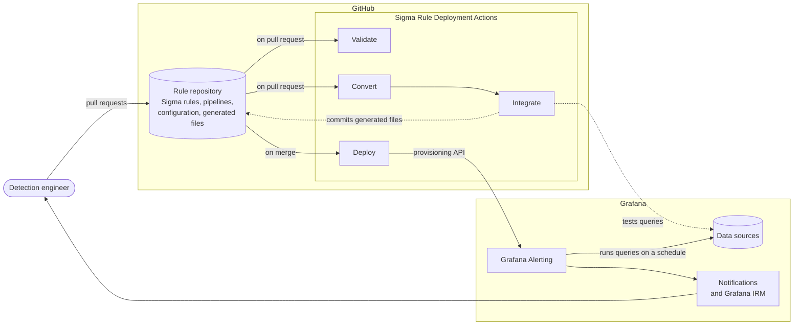
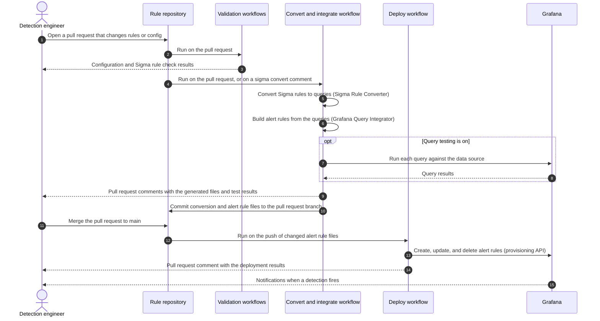

# How Sigma Rule Deployment works

Sigma Rule Deployment applies Detection as Code to Grafana Alerting. You store Sigma rules and a configuration file in a GitHub repository, and GitHub Actions convert the rules into queries, build Grafana alert rules from them, test them, and deploy them. This page explains the approach and what happens at each stage.

## Detection as Code

Detection as Code (DaC) is a practice where you manage security detections the way you manage software. Detection rules live in structured, human-readable files. Git tracks every change, and automated pipelines deploy the rules so every environment stays consistent and traceable.

Sigma Rule Deployment implements DaC with three building blocks. [Sigma](https://sigmahq.io/) provides a standard, vendor-neutral format for detection logic, with thousands of community rules to start from. [Sigma CLI](https://github.com/SigmaHQ/sigma-cli) converts those rules into the query language of your data source, for example, LogQL for Loki. Grafana runs the queries on a schedule as alert rules and notifies you, or [Grafana IRM](https://grafana.com/docs/grafana-cloud/alerting-and-irm/irm/), when a detection fires.

## Architecture

Sigma Rule Deployment runs as GitHub Actions between two systems you already use. Your rule repository on GitHub holds your Sigma rules, pipelines, and configuration, plus the files the Actions generate from them. Grafana holds the data sources your logs live in, and runs the alert rules.

Pull requests drive the validate, convert, and integrate stages, which commit the generated files back to the pull request so you can review them. Merging drives the deploy stage, which provisions the alert rules to Grafana. From then on, Grafana runs the queries on a schedule and notifies you when a detection fires. The configuration file controls every stage: which rules and pipelines to convert, which data source and folder the alert rules use, and which Grafana instances they deploy to.

## The pipeline

The Actions run as four stages. The first three run on pull requests, so you can review every change before it reaches Grafana. The last one runs when you merge.

1. **Validate.** The Config Validator checks your configuration file against the JSON schema, and the SigmaHQ Sigma Rules Validator checks your rule files against the Sigma specification.
1. **Convert.** The Sigma Rule Converter converts each changed Sigma rule into a query with Sigma CLI and writes the result to a JSON _conversion file_.
1. **Integrate.** The Grafana Query Integrator reads the conversion files and writes a Grafana alert rule, a _deployment file_, for each one. If you enable query testing, it also runs each query against your data source and reports the results on the pull request.
1. **Deploy.** After you merge, the Sigma Rule Deployer creates, updates, and deletes alert rules in Grafana to match the deployment files.

The convert and integrate stages commit the generated files back to your pull request branch in a commit named "Sigma Rules Deployment". Reviewers see the exact queries and alert rules that the deploy stage provisions, alongside the rule changes that produced them.

The following diagram shows how the workflows interact with you, your repository, and Grafana over the life of a pull request.

## Generated files

Your configuration file defines two folders, and the Actions own the files in them.

The `conversion_path` folder holds one JSON conversion file per Sigma rule file and configuration, named `<CONFIGURATION_NAME>_<RULE_FILE_NAME>.json`. Each file contains the converted queries and the rule metadata that the integrate stage uses.

The `deployment_path` folder holds one JSON alert rule file per conversion file. These are the files the deploy stage provisions to Grafana.

The Actions regenerate these files on every run and remove them when you remove the source rule. If you need to edit a generated file by hand, refer to [Preserve manual modifications](../use/manual-modifications.md).

## Configurations

A configuration file contains one or more named _configurations_. Each configuration selects a set of Sigma rule files and says how to convert them, which data source and Grafana folder their alert rules use, and which Grafana instance they deploy to. Shared settings go in a `defaults` block. Refer to [Configuration file](../configure/README.md) for details.

## Related pages

- [Get started](../get-started.md)
- [Set up the workflows](../set-up/workflows.md)
- [Configuration file](../configure/README.md)
