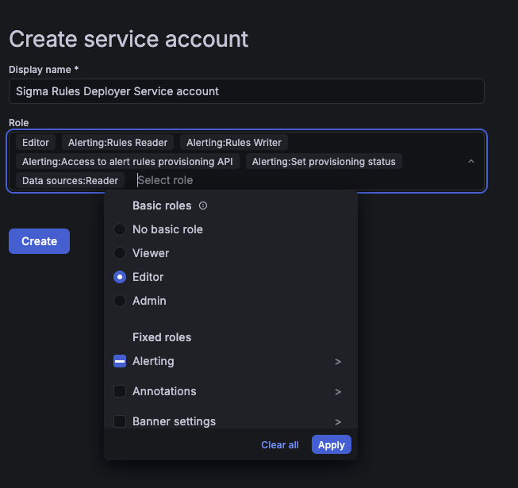
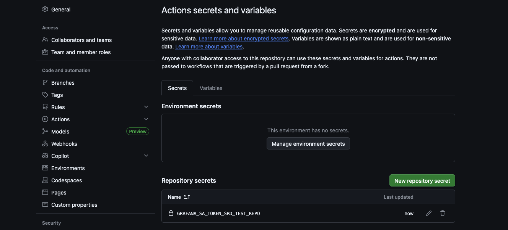

# Create a Grafana service account token

The Actions authenticate to Grafana with a [service account](https://grafana.com/docs/grafana/latest/administration/service-accounts/) token. The integrate stage uses it to test queries against your data sources, and the deploy stage uses it to provision alert rules. Create the token before you set up the workflows.

## Before you begin

You need a Grafana instance, either in [Grafana Cloud](https://grafana.com/docs/grafana-cloud/get-started/) or self-managed, and a user with [permission to create service accounts](https://grafana.com/docs/grafana/latest/administration/service-accounts/#before-you-begin). You also need admin access to the GitHub repository that holds your rules, so you can add secrets.

## Create the service account

Create a service account in Grafana and give it the permissions the Actions need.

1. In Grafana, go to **Administration** > **Users and access** > **Service accounts** and create a service account.
1. Assign it the **Editor** role, or, for least privilege, the following RBAC roles:
   - **Alerting: Access to alert rules provisioning API**
   - **Alerting: Rules Reader**
   - **Alerting: Rules Writer**
   - **Alerting: Set provisioning status**
   - **Data sources: Reader**
1. Add a token to the service account and copy it.

The deploy stage needs the four alerting roles. The integrate stage needs only **Data sources: Reader**, and only when query testing is on. If you want separate tokens for each stage, you can split the roles that way.



## Store the token as a GitHub secret

Never commit the token to your repository. Store it as an [Actions secret](https://docs.github.com/en/actions/security-for-github-actions/security-guides/using-secrets-in-github-actions) instead.

1. In your GitHub repository, go to **Settings** > **Secrets and variables** > **Actions**.
1. Click **New repository secret**.
1. Name the secret, for example, `GRAFANA_SA_TOKEN`, and paste the token as the value.
1. Click **Add secret**.

The workflow templates pass a secret named `GRAFANA_SA_TOKEN` to the reusable workflows. If you choose another name, update the workflows to match.



## Use more than one Grafana instance

If your configurations deploy to more than one Grafana instance, each instance needs a token created in that instance. Store all of them in the same secret as a JSON object that maps each instance URL, as written in `grafana_instance`, to its token:

```json
{
  "https://prod.grafana.net": "<PROD_TOKEN>",
  "https://staging.grafana.net": "<STAGING_TOKEN>"
}
```

With a JSON object, the following rules apply:

- Every instance a configuration tests queries against or deploys to must have a token. The deploy stage fails before it deploys anything if a token is missing, so no alert rule is skipped silently.
- An instance only ever uses its own token. There's no fallback token.
- URLs match regardless of case, a default port, or a trailing slash, so `https://Prod.grafana.net/` matches `https://prod.grafana.net`.
- The Actions mask each token in the logs, as well as the object as a whole.

If you use one instance, or several instances that share a token, store the plain token instead. The Actions use it for every instance.

## Next steps

- [Organize rules and pipelines](rules-and-pipelines.md)
- [Set up the workflows](workflows.md)
