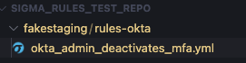
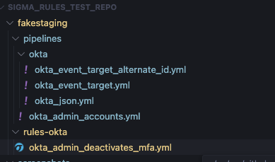

# Organize rules and pipelines

Your rule repository holds Sigma rules, the Sigma pipelines that adapt them to your data, and the Sigma Rule Deployment configuration file. This page describes a layout that works well and the requirements your rule files must meet.

## Repository layout

The Actions don't require a fixed layout, because the configuration file sets every path. Following the [SigmaHQ/sigma](https://github.com/SigmaHQ/sigma) convention of `rules*` folders for rules and a `pipelines` folder for pipelines keeps your repository familiar to anyone who knows Sigma, and matches the paths the workflow templates watch.

```text
your-repo/
├── rules/                  Sigma rules
│   ├── cloud/
│   └── endpoint/
├── rules-correlation/      Sigma correlation rules, kept apart from other rules
├── pipelines/              Sigma pipelines
│   └── datasources/
├── conversions/            generated by the convert stage
├── deployments/            generated by the integrate stage
├── config.yml              Sigma Rule Deployment configuration
└── .github/
    └── workflows/
```

Group rules in a way that maps cleanly onto configurations, for example, by log source or by team. Each configuration selects its rules with glob patterns, so a folder per log source keeps those patterns short.



## Rule requirements

Every rule file must be a valid [Sigma rule](https://sigmahq.io/docs/basics/rules.html) and must include the `id` and `title` [metadata fields](https://sigmahq.io/docs/basics/rules.html#available-sigma-metadata-fields). The `id` must be a UUID, as the Sigma specification requires. The integrate stage uses the two fields to identify and name the alert rule, and fails if an `id` isn't a valid UUID.

A [correlation rule](https://sigmahq.io/docs/meta/correlations.html) must be in the same file as every rule it references. Combine them with YAML's multiple-document separator, `---`.

> [!IMPORTANT]
> The SigmaHQ Sigma Rules Validator doesn't support files with more than one YAML document. Keep correlation rules in a separate folder, for example, `rules-correlation/`, and leave that folder out of the validator's paths.

## Pipelines

[Sigma pipelines](https://sigmahq.io/docs/digging-deeper/pipelines.html) are YAML files that map Sigma's generic field names onto the fields in your data and apply backend-specific transformations. Each configuration lists the pipelines to apply in its `conversion.pipelines` setting, either as paths relative to the repository root or as the names of pipelines that an installed backend plugin provides.



## Next steps

- [Set up the workflows](workflows.md)
- [Configuration file](../configure/README.md)
